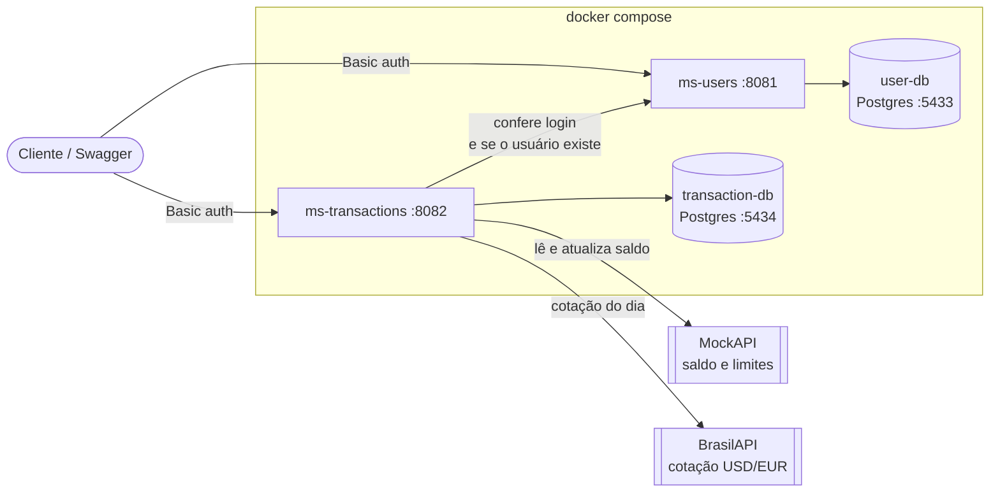

# BECA - API de Gestão Financeira

Projeto do desafio BECA Java 2026. São dois microsserviços em Spring Boot usando arquitetura hexagonal:

- **ms-users** (porta 8081): cadastro de usuários, importação por CSV e login. [Ver README](ms-users/README.md)
- **ms-transactions** (porta 8082): transações, saldo, despesas, câmbio e relatório CSV. [Ver README](ms-transactions/README.md)

## Como funciona



Cada serviço tem seu próprio banco. O ms-transactions pergunta ao ms-users se o login está certo, pega o saldo na MockAPI e a cotação do dólar e do euro na BrasilAPI.

## O que precisa ter instalado

- Docker com Compose
- Uma conta no [mockapi.io](https://mockapi.io) (é de graça)
- JDK 21 e Maven, só se for rodar pela IDE

## Deploy na Azure

O projeto também está disponível numa VM da Azure! Os links do Swagger são:

- ms-users: <http://172.215.136.28:8081/swagger-ui.html>
- ms-transactions: <http://172.215.136.28:8082/swagger-ui.html>

## Como rodar

1. Clone o projeto:

   ```bash
   git clone https://github.com/Alclides/desafio-beca-nttdata.git
   cd desafio-beca-nttdata
   ```

2. Crie o `.env` a partir do exemplo:

   ```bash
   cp .env.example .env
   ```

3. Preencha no `.env`:

   | Variável | O que colocar |
   |---|---|
   | `DB_USER` | um usuário qualquer para o banco (obrigatório) |
   | `DB_PASSWORD` | uma senha qualquer para o banco (obrigatório) |
   | `MOCKAPI_URL` | a URL do seu projeto no mockapi.io |

   As outras variáveis do `.env.example` só são usadas quando roda pela IDE.

4. Suba tudo:

   ```bash
   docker compose up --build
   ```

5. Abra o Swagger:
   - ms-users: <http://localhost:8081/swagger-ui.html>
   - ms-transactions: <http://localhost:8082/swagger-ui.html>

   Clique em **Authorize** e coloque o e-mail e a senha de um usuário.

Para parar: `docker compose down`. Para apagar os bancos também: `docker compose down -v`.

## Configurando a MockAPI

O saldo de cada usuário fica na MockAPI.

1. Crie um projeto no mockapi.io.
2. Crie um recurso chamado `accounts` com os campos:
   - `userId` (Number): o id do usuário no ms-users
   - `balance` (Number): saldo
   - `dailyLimit` (Number): limite por dia
   - `perTransactionLimit` (Number): limite por transação
3. Cadastre uma conta para cada usuário, por exemplo:

   ```json
   { "userId": 1, "balance": 1000.00, "dailyLimit": 500.00, "perTransactionLimit": 300.00 }
   ```

4. Coloque a URL do projeto no `.env` (sem `/` no final):

   ```properties
   MOCKAPI_URL=https://SEU-ID.mockapi.io/api/v1
   ```

## Login

Os dois serviços usam **Basic Auth** com e-mail e senha.

Rotas abertas (sem login):
- `POST /users` (cadastro)
- `POST /users/upload` (importar CSV)
- `POST /users/authenticate`
- Swagger

Todas as outras precisam de login. Cada usuário só consegue ver e mexer nos próprios dados.

## Testando na prática

1. Importar os usuários do CSV de exemplo:

   ```bash
   curl -F "file=@samples/usuarios.csv" http://localhost:8081/users/upload
   ```

2. Ver o saldo:

   ```bash
   curl -u ana.souza@exemplo.com:senha123 http://localhost:8082/users/1/balance
   ```

3. Fazer uma compra:

   ```bash
   curl -u ana.souza@exemplo.com:senha123 -H "Content-Type: application/json" \
     -d '{"userId":1,"type":"PURCHASE","amount":89.90,"description":"Mercado","category":"ALIMENTACAO"}' \
     http://localhost:8082/transactions
   ```

4. Ver as despesas:

   ```bash
   curl -u ana.souza@exemplo.com:senha123 http://localhost:8082/users/1/expenses/summary
   ```

5. Baixar o relatório:

   ```bash
   curl -u ana.souza@exemplo.com:senha123 -o relatorio.csv http://localhost:8082/transactions/report
   ```

## Testes

Dentro da pasta de cada serviço:

```bash
mvn test
```

O relatório do JaCoCo fica em `target/site/jacoco/index.html`.

| Serviço | Testes | Cobertura | Cobertura do domínio |
|---|---|---|---|
| ms-users | 58 | 89% | 100% |
| ms-transactions | 185 | 89,5% | 100% |

## Rodando pela IDE

Suba só os bancos:

```bash
docker compose up -d user-db transaction-db
```

Depois rode o `MsUsersApplication` e o `MsTransactionsApplication`. Eles leem o `.env` da raiz sozinhos. Rode o ms-users primeiro.
