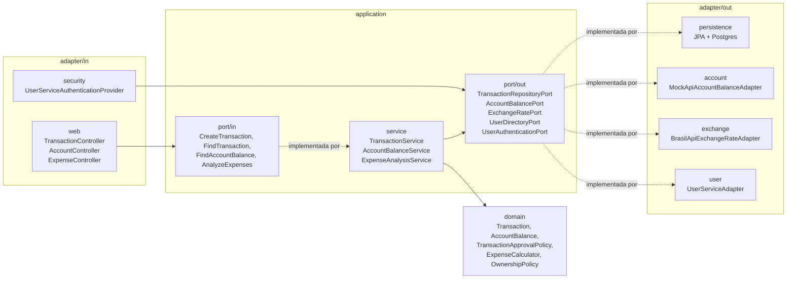

# ms-transactions

Serviço de transações. Registra depósitos, retiradas, transferências e compras, aprova ou rejeita cada uma, mostra o saldo, as despesas e gera o relatório CSV.

- Porta: 8082
- Swagger: <http://localhost:8082/swagger-ui.html>
- Banco: Postgres `transactions_db`
- Usa: ms-users (login), MockAPI (saldo) e BrasilAPI (câmbio)

Para subir o projeto inteiro, veja o [README da raiz](../README.md).

## Arquitetura



- `domain`: a `Transaction` e as regras de aprovação, sem Spring
- `application`: as portas (interfaces) e os services
- `adapter/in`: controllers e login
- `adapter/out`: banco, MockAPI, BrasilAPI e ms-users
- `config`: liga tudo (`BeanConfig`)

## Endpoints

Todos precisam de login, e cada usuário só vê os próprios dados.

| Método | Rota | O que faz |
|---|---|---|
| `POST` | `/transactions` | Cria uma transação |
| `GET` | `/transactions/{id}` | Busca uma transação |
| `GET` | `/transactions?userId=` | Lista as transações |
| `GET` | `/transactions/report` | Baixa o relatório CSV |
| `GET` | `/users/{userId}/balance` | Saldo e limites |
| `GET` | `/users/{userId}/expenses/summary` | Despesas por categoria |
| `GET` | `/users/{userId}/expenses/daily` | Despesas por dia |
| `GET` | `/users/{userId}/expenses/monthly` | Despesas por mês |

As listas aceitam `from` e `to` (`AAAA-MM-DD`). Sem data, mostra o mês atual.

## Regras

**Tipos:** `DEPOSIT`, `WITHDRAWAL`, `TRANSFER`, `PURCHASE`

**Categorias:** `ALIMENTACAO`, `TRANSPORTE`, `MORADIA`, `SAUDE`, `LAZER`, `EDUCACAO`, `VIAGENS`, `OUTROS`

- Compra precisa de categoria
- Transferência precisa de `destinationUserId`
- Depósito é aprovado direto
- Retirada, transferência e compra são rejeitadas se passarem do limite por transação, do limite diário ou do saldo
- A transação rejeitada também fica salva, com o motivo
- Se a MockAPI ou o ms-users estiverem fora, a transação fica como `REJECTED`
- Se a BrasilAPI estiver fora, a transação é salva sem a conversão

## Estorno

A transação nunca é apagada. Para corrigir, cria-se uma nova com o `correctedTransactionId`, o mesmo valor e o tipo contrário:

```json
{ "userId": 1, "type": "DEPOSIT", "amount": 89.90, "correctedTransactionId": 4 }
```

Cada transação só pode ser estornada uma vez.

## Relatório CSV

Usa `;` como separador para abrir direto no Excel:

```csv
data;tipo;categoria;descrição;valor em real;status;motivo
03/11/2026;PURCHASE;EDUCACAO;Notebook;450,00;REJECTED;Valor excede o limite por transação
03/11/2026;PURCHASE;ALIMENTACAO;Mercado;89,90;APPROVED;
```

## Testes

```bash
mvn test
```
