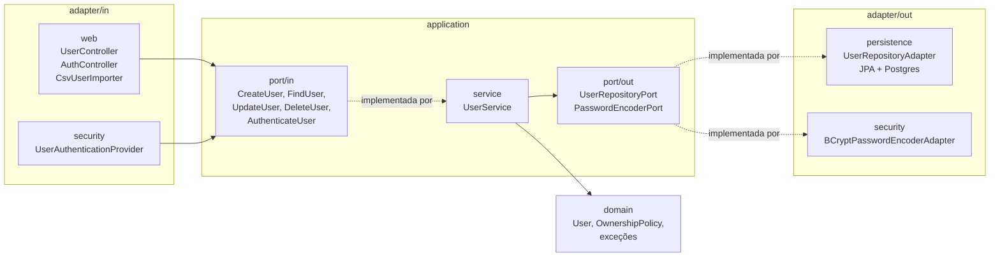

# ms-users

Serviço de usuários. Faz o cadastro, a importação por CSV e confere o login para os dois serviços.

- Porta: 8081
- Swagger: <http://localhost:8081/swagger-ui.html>
- Banco: Postgres `users_db`

Para subir o projeto inteiro, veja o [README da raiz](../README.md).

## Arquitetura



- `domain`: o `User` e as regras, sem Spring
- `application`: as portas (interfaces) e o `UserService`
- `adapter/in`: controllers e login
- `adapter/out`: banco e BCrypt
- `config`: liga tudo (`BeanConfig`)

## Endpoints

| Método | Rota | Precisa de login? |
|---|---|---|
| `POST` | `/users` | não |
| `POST` | `/users/upload` | não |
| `POST` | `/users/authenticate` | não |
| `GET` | `/users` | sim |
| `GET` | `/users/{id}` | sim |
| `PUT` | `/users/{id}` | sim, só o dono |
| `DELETE` | `/users/{id}` | sim, só o dono |

## Regras

- Nome obrigatório, até 100 caracteres
- E-mail obrigatório, válido e sem repetir
- Senha entre 6 e 72 caracteres
- A senha é salva com BCrypt e nunca aparece na resposta

## CSV

O arquivo precisa ter o cabeçalho `name,email,password`:

```csv
name,email,password
Ana Souza,ana.souza@exemplo.com,senha123
Bruno Lima,bruno.lima@exemplo.com,senha123
```

Se uma linha tiver erro, as outras continuam sendo importadas, e a resposta mostra qual linha deu erro e por quê.

Exemplos na pasta [samples](../samples).

## Testes

```bash
mvn test
```
